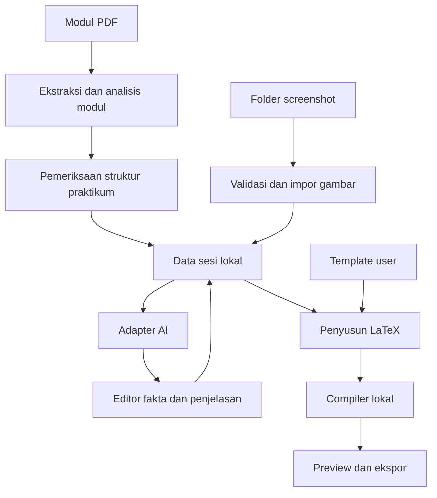

# PRD — Asisten Laprak Jaringan Komputer Berbasis AI

Versi: 1.0  
Tanggal: 11 Oktober 2026  
Status: spesifikasi MVP untuk implementasi di Codex  
Nama produk: nama kerja; nama final belum ditentukan

## 1. Ringkasan produk

Aplikasi desktop Windows yang membantu mahasiswa menyusun laporan praktikum Jaringan Komputer menggunakan Cisco Packet Tracer. User mengunggah modul PDF sebagai dasar pekerjaan, menggunakan template LaTeX miliknya, dan mengambil screenshot melalui alat yang sudah digunakan. Aplikasi memantau folder screenshot, mengelompokkan bukti, meminta analisis kepada AI yang terhubung, menyediakan pemeriksaan dan penyuntingan, lalu menghasilkan PDF dan sumber LaTeX.

Pekerjaan dan aset tersimpan lokal. Layanan AI menerima hanya materi yang diperlukan untuk operasi yang dipilih. Tidak ada akun aplikasi, backend pusat, atau sinkronisasi cloud pada MVP.

## 2. Masalah dan tujuan

Penyusunan laprak memerlukan pemindahan gambar, penulisan dokumentasi, pemeriksaan tugas pada modul, dan penataan format berulang. Screenshot saja tidak selalu menjelaskan tindakan atau tujuan; AI dapat salah membaca konfigurasi atau menganggap instruksi modul sebagai hasil aktual.

Tujuan produk:
- Mengurangi pekerjaan manual penyisipan gambar dan penyusunan dokumentasi.
- Mempertahankan format template LaTeX user.
- Menghasilkan draf yang dapat diperiksa berdasarkan sumber dan bukti.
- Membantu menemukan instruksi dan tugas yang belum terdokumentasi.
- Mendukung integrasi AI yang dapat diganti tanpa ketergantungan pada satu provider.
- Memulihkan pekerjaan ketika aplikasi atau koneksi AI terputus.

Keberhasilan praktikum tetap ditentukan dari bukti dan pemeriksaan user, bukan keberadaan screenshot.

## 3. Target user dan platform

Target awal: mahasiswa Jaringan Komputer yang menggunakan Cisco Packet Tracer dan memiliki template LaTeX. Platform sasaran MVP: Windows 10/11 x64, dengan validasi kompatibilitas dilakukan saat pengembangan. Antarmuka dan draf laporan default berbahasa Indonesia; identitas dan isi laporan dapat diedit.

## 4. Ruang lingkup

### Wajib pada MVP
- Setup lingkungan, deteksi compiler, dan pemeriksaan template.
- Satu template LaTeX user yang diadaptasi secara eksplisit untuk aplikasi.
- Pembuatan sesi dengan identitas, modul PDF wajib, dan folder screenshot.
- Ekstraksi teks PDF serta jalur analisis halaman bergambar/scan menggunakan provider vision yang mendukung.
- Analisis modul menjadi tujuan, teori, instruksi, tugas, dan kebutuhan bukti.
- Pemeriksaan hasil analisis modul sebelum dipakai sebagai panduan.
- Pemantauan folder dan impor screenshot manual.
- Pengelompokan beberapa screenshot dalam satu langkah.
- Pemilihan tahap aktif, catatan opsional, koreksi fakta, dan editor penjelasan.
- Satu adapter AI nyata yang dipilih berdasarkan akses user; arsitektur mendukung penambahan adapter.
- Antrean AI persisten, retry, pembatalan, dan mode penulisan manual saat AI gagal.
- Checklist kelengkapan, penyusunan LaTeX, preview PDF, dan ekspor proyek.
- Autosave dan pemulihan sesi.

### Di luar MVP
- Mengoperasikan atau mengonfigurasi Packet Tracer secara otomatis.
- Membaca file .pkt sebagai sumber konfigurasi yang dianggap lengkap.
- Akun, kolaborasi, cloud, aplikasi mobile, dan ekspor DOCX.
- Konversi otomatis semua template LaTeX tanpa adaptasi.
- Perekaman layar terus-menerus atau pengambilan screenshot otomatis.
- Integrasi OpenCode melalui mekanisme yang belum diverifikasi.
- Jawaban otomatis tanpa pemeriksaan user atau klaim keberhasilan tanpa bukti.

## 5. Prinsip sumber informasi

| Sumber | Peran | Batas |
|---|---|---|
| Modul PDF | Instruksi, tujuan, teori, tugas | Tidak membuktikan pekerjaan telah dilakukan |
| Screenshot | Bukti konfigurasi dan hasil yang terlihat | Tidak membuktikan tindakan yang tidak terlihat |
| Catatan user | Konteks tindakan, kendala, dan perbaikan | Ditandai sebagai keterangan user |
| Template LaTeX | Struktur dan tampilan | Bukan sumber fakta praktikum |

Setiap instruksi hasil ekstraksi menyimpan nomor halaman PDF. Nomor halaman file dan nomor tercetak dibedakan jika keduanya tersedia. Fakta yang tidak terbaca ditandai sebagai tidak diketahui; sistem tidak mengisi nilai dengan tebakan.

## 6. Alur utama

1. Pada instalasi, installer menawarkan pemeriksaan dependensi. Wizard wajib menjalankan pemeriksaan lengkap pada peluncuran pertama dan setelah lokasi compiler berubah.
2. User memilih template; aplikasi menentukan engine dari manifest atau pilihan user dan memberi saran berdasarkan isi template.
3. User membuat sesi, mengisi identitas, mengunggah PDF modul, dan memilih folder screenshot.
4. Aplikasi mengekstrak modul; AI mengubahnya menjadi struktur praktikum. User memeriksa dan menyetujui struktur tersebut.
5. User memilih tahap aktif dan mulai praktik di Packet Tracer.
6. Screenshot masuk; aplikasi menunggu file stabil, memvalidasi gambar, dan menyalinnya ke aset proyek.
7. Gambar ditambahkan ke langkah aktif atau langkah baru sesuai mode yang dipilih user.
8. AI mengekstrak fakta yang terlihat dan menyarankan kaitan dengan instruksi modul. User dapat mengoreksinya.
9. AI membuat draf penjelasan; user mengedit dan menyetujui. Semua keluaran otomatis tetap berstatus draf.
10. User memeriksa checklist, menyusun pembahasan dan kesimpulan dari hasil yang telah diperiksa, lalu membangun laporan.
11. Aplikasi mengisi template, mengompilasi, menampilkan PDF, dan menyediakan ekspor.

Analisis otomatis setelah screenshot masuk dapat diaktifkan, dengan batas antrean. Mode hemat kuota memerlukan tombol Analisis. Persetujuan isi tidak otomatis.

## 7. Kebutuhan fungsional

### FR-01 — Setup compiler dan template
- Cari executable engine yang diperlukan melalui PATH, lokasi umum distribusi, dan lokasi manual user.
- Bedakan engine (XeLaTeX, LuaLaTeX, pdfLaTeX) dari distribusi (MiKTeX, TeX Live).
- MiKTeX menjadi kandidat panduan instalasi awal Windows; pemilihan final dan tautan resmi diverifikasi saat implementasi. Instalasi TeX Live yang memenuhi kebutuhan diterima.
- Tidak memaksa distribusi kedua ketika engine yang sesuai sudah tersedia.
- Jalankan pemeriksaan versi, kompilasi dokumen kecil, lalu kompilasi template asli.
- Tampilkan diagnosis terpisah: executable tidak ditemukan, paket hilang, font hilang, timeout, atau sintaks gagal.
- Jika compiler belum tersedia, tampilkan panduan instalasi dan tombol Periksa Ulang. Tidak mengunduh atau menjalankan installer secara diam-diam.
- Penyusunan sesi tetap tersedia; Build PDF terkunci sampai compiler dan template lolos pemeriksaan.
- latexmk bersifat orkestrator yang diutamakan jika tersedia; jika tidak, jalankan engine dengan pengulangan terbatas untuk referensi. Bibliografi kompleks di luar MVP kecuali template memerlukannya dan ditambahkan secara eksplisit.

### FR-02 — Sesi lokal
- Identitas: nama, NIM, kelas, mata kuliah, judul praktikum, tanggal, dan isian tambahan sesuai template.
- Modul wajib sebelum alur analisis dokumentasi dimulai. Template dan sesi dapat disiapkan sebelumnya.
- Salin modul dan aset pendukung ke proyek agar sesi tidak tergantung file asal.
- Sediakan buka sesi, duplikasi sesi, dan ekspor proyek. Duplikasi tidak membawa kredensial.

### FR-03 — Pembacaan modul
- Validasi PDF dapat dibuka; tampilkan batas ukuran/halaman yang dapat dikonfigurasi.
- Ekstraksi per halaman, mempertahankan asal halaman. Jangan menganggap ekstraksi teks biasa mempertahankan seluruh tabel atau diagram.
- Halaman kosong hasil ekstraksi atau scan diarahkan ke analisis vision; jika provider tidak mendukung, tampilkan kebutuhan provider yang sesuai dan izinkan koreksi teks manual. OCR lokal dapat ditambahkan pada iterasi berikutnya.
- Pecah modul panjang menurut bagian/halaman dan simpan hasil analisis, hash berkas, model, serta versi prompt.
- Struktur: tujuan, teori, alat, instruksi, tugas tambahan, kebutuhan bukti, dan bagian yang belum terbaca.
- Mengganti modul membuat pemetaan lama perlu diperiksa; tidak menghapus edit user.

### FR-04 — Screenshot
- Format MVP: PNG dan JPEG; file rusak tidak diproses.
- Abaikan file sementara dan keluaran aplikasi sendiri. Cegah loop jika folder output berada dekat folder yang dipantau.
- Tunggu ukuran dan waktu modifikasi stabil sebelum membuka file; retry terbatas untuk file terkunci.
- Simpan gambar asli; crop dan resize sebagai turunan yang tidak merusak sumber.
- Deteksi duplikat persis dengan hash. User dapat tetap mempertahankan gambar; kemiripan visual otomatis adalah fitur lanjutan.
- Mode penempatan: tambahkan ke langkah aktif atau buat langkah baru. Gambar yang datang saat tahap berubah mempertahankan konteks saat diimpor.
- Sediakan pindah langkah, ubah urutan, hapus dari laporan, dan impor manual.

### FR-05 — Analisis fakta dan narasi
- Keluaran terstruktur: perangkat, IP/prefix, gateway, interface, VLAN, route, perintah, hasil uji, dan informasi yang belum jelas; field boleh kosong jika tidak relevan.
- Fakta memiliki sumber gambar/catatan/modul dan status belum diperiksa atau diperiksa.
- Perintah yang hanya terlihat diketik tidak otomatis dinyatakan berhasil dijalankan.
- Ping gagal ditulis sebagai gagal; kesuksesan sebagian dijelaskan sesuai bukti.
- User dapat mengoreksi fakta sebelum membuat narasi. Mode otomatis boleh membuat draf awal tetapi menandai fakta belum diperiksa.
- Penjelasan menyebut tindakan, konfigurasi, tujuan, dan hasil hanya jika memiliki konteks yang cukup.
- Tidak menulis konfigurasi atau pengujian yang tidak dibuktikan seolah sudah dilakukan.
- Regenerasi membuat revisi baru dan tidak menimpa edit user tanpa pilihan eksplisit.
- Perubahan gambar, fakta, atau konteks menandai narasi lama sebagai perlu diperiksa ulang.

### FR-06 — AI dan kuota
- Settings: provider, endpoint yang didukung, model, kredensial, timeout, ukuran gambar, dan batas permintaan.
- Periksa kemampuan text, vision, input PDF bila tersedia, dan structured output; jangan mengasumsikan semua endpoint kompatibel.
- Pembacaan PDF dapat memakai ekstraksi lokal dan gambar halaman sehingga tidak bergantung pada dukungan PDF native.
- Sediakan Test Connection dan contoh uji kemampuan tanpa mengirim modul user.
- Operasi internal: analyze_module, analyze_screenshot, generate_explanation, generate_discussion, generate_conclusion.
- OpenCode diperlakukan sebagai kandidat penghubung/alat, bukan jaminan model gratis. Adapter CLI hanya dikembangkan setelah antarmuka, autentikasi, dan keluaran terstrukturnya diverifikasi.
- Tidak menjanjikan free tier tanpa batas. User menyediakan akses yang didukung; aplikasi tidak melewati limit provider.
- Default satu job AI aktif; retry terbatas dengan backoff untuk error sementara, menghormati Retry-After. Error autentikasi menghentikan antrean sampai diperbaiki.
- Tampilkan perkiraan jumlah permintaan; biaya hanya ditampilkan jika data harga tersedia, bukan angka tebakan.
- Cache analisis berdasarkan input, model, prompt, dan konteks. Jangan mengirim ulang seluruh modul untuk setiap gambar.
- Kegagalan AI tidak menghalangi edit manual atau build dari isi yang sudah tersedia.

### FR-07 — Kelengkapan dan bagian laporan
- Checklist menyimpan pemetaan instruksi ke langkah, bukti, tugas, dan jawaban.
- Status kelengkapan: belum ada bukti, bukti tersedia, perlu diperiksa, lengkap, atau tidak berlaku dengan alasan user.
- Status hasil pengujian terpisah: belum diketahui, sukses, gagal, atau sebagian sukses.
- Pembahasan dan kesimpulan memakai langkah yang diperiksa, menyebut keterbatasan dan kegagalan yang relevan.
- Jawaban teori harus memiliki sumber modul yang relevan atau ditandai sebagai penjelasan tambahan untuk diperiksa; tidak membuat sitasi palsu.
- Preview draf boleh dibangun saat belum lengkap dengan indikator di UI. Ekspor final mensyaratkan penyelesaian pemeriksaan; item tidak berlaku membutuhkan alasan. Hasil gagal tidak otomatis memblokir final jika sudah didokumentasikan.

### FR-08 — LaTeX dan ekspor
- Template asli dipertahankan; perubahan adaptasi dilakukan pada salinan proyek.
- Manifest template menetapkan main.tex, engine, field identitas, bagian yang dihasilkan, dan aset wajib.
- Gunakan Jinja2 dengan delimiter yang tidak bertabrakan dengan sintaks LaTeX; escape teks biasa dilakukan terpusat.
- Karakter khusus seperti %, &, _, #, $, kurung kurawal, tilde, caret, dan backslash ditangani sesuai konteks. Blok CLI memakai lingkungan kode khusus, bukan escape paragraf biasa.
- AI mengeluarkan data/teks, bukan perintah LaTeX bebas.
- Sisipkan dokumentasi melalui file generated yang dipanggil template. Struktur bab menyesuaikan template yang diberikan, tidak diasumsikan sebelum diperiksa.
- Gunakan nama aset aman, rasio gambar terjaga, caption bernomor, dan ukuran maksimum berdasarkan area teks. Gambar tidak boleh melewati margin; teks CLI perlu tetap terbaca.
- Build dijalankan sebagai subprocess dengan argumen terpisah, tanpa shell escape, direktori build terpisah, timeout, dan tombol batal.
- Kegagalan build mempertahankan PDF berhasil terakhir; tampilkan status bahwa preview tersebut berasal dari revisi lama.
- Ekspor PDF dan ZIP proyek berisi sumber .tex, gambar, modul, data portable, dan manifest. Kredensial/log sensitif tidak ikut ekspor.

## 8. Antarmuka

Wizard setup: compiler, template, uji kompilasi, lalu provider AI. Status compiler dan status AI terpisah.

Dashboard: daftar sesi dan tombol sesi baru. Editor sesi memiliki panel kiri untuk langkah dan checklist, panel tengah untuk gambar serta fakta/catatan, panel kanan untuk penjelasan dan tab preview PDF. Tahap aktif, mode penempatan gambar, serta status antrean selalu terlihat.

Kontrol utama: Upload Modul, Pilih Folder, Analisis, Coba Ulang, Setujui, Build Draf, dan Ekspor Final. Kesalahan disampaikan dengan tindakan berikutnya yang konkret. User dapat menghentikan job tanpa kehilangan sesi.

## 9. Arsitektur dan stack usulan

Pilihan berikut merupakan arah implementasi, bukan klaim kompatibilitas seluruh versi. Versi dependensi, lisensi distribusi, dan API provider harus diverifikasi dan dikunci saat implementasi.

| Lapisan | Pilihan |
|---|---|
| Desktop | Python + PySide6 |
| File watcher | watchdog |
| PDF extraction/render | PyMuPDF; evaluasi lisensi sebelum distribusi |
| Pengolahan gambar | Pillow |
| HTTP provider | httpx |
| Schema AI | Pydantic |
| Penyimpanan | SQLite + folder aset |
| Template | Jinja2 + escape berdasarkan konteks |
| Kompilasi | latexmk bila tersedia + engine sesuai manifest |
| Preview | Qt PDF; fallback renderer lokal jika bundling membutuhkan |
| Kredensial | Windows Credential Manager melalui integrasi keyring yang diverifikasi |
| Packaging | PyInstaller + installer Windows |

UI tidak menjalankan pekerjaan berat pada thread utama. Worker menangani ekstraksi PDF, AI, dan kompilasi. SQLite memakai transaksi, migrasi schema, serta snapshot data saat build agar perubahan editor tidak mencampur revisi.



## 10. Model data minimum

| Entitas | Field penting |
|---|---|
| Session | id, identitas, judul, tanggal, template_id, module_id, folder_watch, revisi |
| Module | hash, path, halaman, teks per halaman, analisis, status pemeriksaan |
| Instruction | id, bagian, deskripsi, halaman sumber, bukti yang diperlukan |
| Step | id, urutan, judul, instruction_ids, catatan, status pemeriksaan |
| Evidence | id, step_id, path asli/turunan, hash, waktu impor, konteks tahap |
| Fact | tipe, nilai, sumber, status pemeriksaan, koreksi user |
| NarrativeRevision | step_id, teks, asal AI/user, input_revision, status |
| Job | jenis, input_revision, status, percobaan, waktu retry, error |
| Template | manifest, engine, main_file, field dan dependency |
| Build | snapshot_revision, status, path PDF, log, waktu |

Job: queued → running → succeeded / failed / cancelled. Setelah crash, job running menjadi interrupted dan dapat dijadwalkan ulang. Respons yang berasal dari revisi lama tidak boleh menggantikan revisi baru secara otomatis.

## 11. Struktur proyek sesi

```text
session-name/
├── session.sqlite
├── module/
│   └── module.pdf
├── screenshots/
│   ├── originals/
│   └── derived/
├── template/
│   ├── manifest.json
│   ├── main.tex
│   └── assets/
├── generated/
│   ├── identity.tex
│   └── documentation.tex
├── build/
└── output/
    └── laporan.pdf
```

Manifest export menyertakan schema version dan data portable untuk impor ulang. Nama asli file boleh disimpan sebagai metadata; path internal memakai ID aman. Folder screenshot eksternal bukan satu-satunya penyimpanan bukti.

## 12. Keandalan dan privasi

- Autosave perubahan dalam target maksimal 2 detik setelah user berhenti mengetik; operasi penting disimpan segera secara transaksional.
- Simpan snapshot sebelum migrasi dan export; pulihkan sesi tanpa menghapus aset.
- Kredensial tidak disimpan di SQLite, ZIP, prompt, atau log. Jika penyimpanan kredensial aman tidak tersedia, gunakan kredensial hanya untuk sesi berjalan.
- Jelaskan pada setup AI bahwa materi dikirim ke provider yang dipilih dan tampilkan lingkup kiriman.
- Perlakukan isi modul/gambar sebagai data; instruksi di dalamnya tidak boleh mengubah aturan aplikasi atau menjalankan perintah.
- Template LaTeX adalah kode yang dijalankan lokal. Gunakan template user yang dipercaya, nonaktifkan shell escape, batasi durasi build, dan validasi path impor/ZIP agar tidak keluar dari folder proyek.
- Tidak ada telemetry pada MVP. Log lokal menyamarkan rahasia dan dapat dibersihkan.

## 13. Target kualitas

Target ini diuji pada mesin referensi Windows yang spesifikasinya dicatat, bukan jaminan untuk seluruh perangkat:
- Screenshot stabil muncul di daftar dalam target 3 detik pada kondisi normal.
- UI tetap dapat dipakai saat ekstraksi, AI, dan build berlangsung.
- Sesi uji 50 screenshot dapat dibuka, diedit, dan diekspor tanpa kehilangan urutan.
- Tidak ada permintaan AI duplikat akibat event watcher berulang.
- Semua draf AI memiliki status pemeriksaan dan sumber bukti/konteks.
- Tidak ada paket/font hilang yang disamarkan sebagai build berhasil.
- PDF hasil template target lolos inspeksi visual untuk margin, caption, keterbacaan gambar, dan urutan.

## 14. Kriteria penerimaan

| ID | Skenario | Hasil wajib |
|---|---|---|
| AC-01 | Compiler belum dipasang | Panduan tampil; Build terkunci; sesi dapat disimpan |
| AC-02 | Compiler tersedia di lokasi manual | Tes kompilasi berhasil dan lokasi tersimpan |
| AC-03 | TeX Live sudah memenuhi engine | Tidak diwajibkan memasang MiKTeX |
| AC-04 | Paket/font template hilang | Diagnosis kebutuhan tampil; PDF lama tidak ditimpa |
| AC-05 | PDF modul digital diunggah | Struktur praktikum memiliki halaman sumber dan dapat diedit |
| AC-06 | PDF scan tanpa kemampuan vision | Status keterbatasan jelas; tidak mengklaim modul telah terbaca |
| AC-07 | File screenshot masih ditulis | Diproses hanya setelah stabil dan valid |
| AC-08 | Dua screenshot satu tahap | Bisa dimasukkan ke satu langkah dan diurutkan |
| AC-09 | Ping timeout pada screenshot | Narasi tidak menyatakan ping sukses |
| AC-10 | IP buram | Nilai ditandai tidak jelas dan dapat dikoreksi |
| AC-11 | Limit provider tercapai | Job tertahan/gagal terjelaskan; edit manual tetap tersedia |
| AC-12 | Aplikasi ditutup saat AI berjalan | Sesi pulih; job tidak dianggap berhasil tanpa hasil |
| AC-13 | User mengedit saat AI menghasilkan respons | Edit tidak ditimpa respons usang |
| AC-14 | Teks mengandung karakter khusus/CLI | LaTeX terkompilasi; isi teks tetap benar |
| AC-15 | Template target dibangun dengan 50 gambar | Tidak ada gambar melewati margin; caption dan urutan benar |
| AC-16 | Proyek diekspor lalu diimpor | Identitas, modul, gambar, narasi, dan urutan dipulihkan |
| AC-17 | Pemeriksaan final belum selesai | Ekspor final memberi daftar item yang perlu diselesaikan |
| AC-18 | Pengujian gagal tetapi telah dijelaskan | Final dapat diekspor setelah pemeriksaan lengkap |

## 15. Tahapan implementasi

1. **Fondasi:** struktur aplikasi, SQLite, editor manual, autosave, dan impor gambar. Hasil: sesi dapat disusun tanpa AI.
2. **Template dan compiler:** adaptasi template nyata user, wizard deteksi, build, preview, dan ekspor. Hasil: laporan manual menghasilkan PDF yang formatnya sesuai.
3. **Modul dan AI:** ekstraksi, adapter nyata, analisis modul, fakta screenshot, revisi narasi, dan antrean. Hasil: satu praktikum lengkap dapat didokumentasikan dengan AI.
4. **Integrasi alur:** watcher, pemetaan instruksi, checklist, pembahasan/kesimpulan, recovery, dan mode hemat kuota.
5. **Distribusi:** packaging, installer, pengujian mesin bersih dengan/tanpa compiler, dan panduan pengguna.

Jangan menambah provider atau otomatisasi baru sebelum alur satu modul, satu template, dan satu provider lolos kriteria penerimaan.

## 16. Risiko dan mitigasi

| Risiko | Mitigasi |
|---|---|
| Provider gratis mengubah batas/kemampuan | Adapter terpisah, batas dapat diatur, manual mode |
| AI salah menafsirkan gambar | Fakta terstruktur, sumber, koreksi, pemeriksaan |
| PDF sulit diekstrak | Analisis per halaman, vision, penandaan bagian gagal |
| Template kompleks | Adaptasi satu template nyata dan manifest eksplisit |
| Font/paket membutuhkan jaringan | Diagnosis dependency dan panduan instalasi; jangan menjanjikan compiler offline tanpa dependency lengkap |
| Tata letak screenshot panjang | Crop turunan, batas ukuran, inspeksi PDF |
| Job berulang atau respons usang | Hash input, revisi, antrean persisten, pemeriksaan sebelum commit |
| Packaging dependency bermasalah | Uji installer pada mesin bersih dan evaluasi lisensi |

## 17. Bahan yang dibutuhkan sebelum implementasi

- Sumber template LaTeX beserta font/aset dan satu PDF contoh hasilnya.
- Satu modul Jaringan Komputer dan screenshot praktikum representatif, termasuk pengujian gagal dan perbaikan.
- Provider/model yang benar-benar dapat diakses user serta kemampuan text/vision-nya.
- Keputusan apakah penjelasan default memakai paragraf, langkah bernomor, atau mengikuti susunan template.

Nama produk, provider default, dan engine template masih terbuka. Ketiganya diselesaikan dari bahan nyata; tidak menghalangi pembuatan fondasi lokal.
